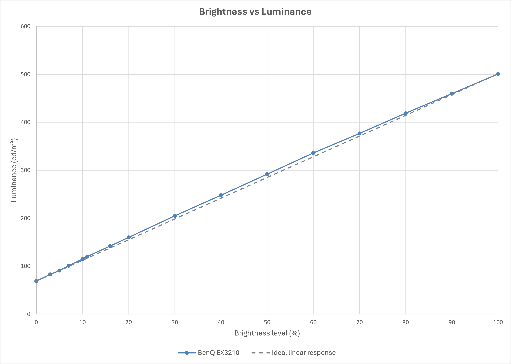

<!-- PAGE_STATUS: DRAFT -->

# BenQ EX3210U   

32-inch 4K UHD IPS gaming monitor featuring a **Quantum Dot-enhanced W-LED edge-lit backlight with 16-zone local dimming**, 144 Hz refresh rate, AMD FreeSync Premium Pro, and 1 ms MPRT response time.

Calibration objective: **comfortable everyday use with reduced eye strain during prolonged use, targeting the sRGB color space.**

Official product page: <https://www.benq.com/en-us/monitor/gaming/ex3210u.html>

## Table of contents

- [Specifications](#specifications)
  - [Color characteristics](#color-characteristics)
- [Calibration](#calibration)
  - [Environment and targets](#environment-and-targets)
  - [OSD settings](#osd-settings)
- [Downloads](#downloads)
  - [ICC/ICM profile](#iccicm-profile)
  - [Reports](#reports)
- [Brightness response curve](#brightness-response-curve)

## Specifications  

| Parameter           | Value                                      |
| ------------------- | ------------------------------------------ |
| Screen size         | 32" (31.5" viewable)                       |
| Panel type          | IPS                                        |
| Aspect ratio        | 16:9                                       |
| Resolution          | 3840 × 2160                                |
| Backlight           | W-LED Edge-lit with Quantum Dot enhancement |
| Local dimming       | 16 zones                                   |
| Refresh rate        | 144 Hz                                     |
| Brightness(typ)     | 300 cd/m²                                  |
| Brightness(peak)    | 600 cd/m² (HDR)                            |
| Contrast ratio      | 1000:1                                     |
| Viewing angle (H/V) | 178°(H)/178°(V)                            |
| Response time       | MPRT 1 ms / GtG 2 ms                       |

### Color characteristics  

**Gamut coverage**

|      Color gamut       | Declared/known coverage | Calibrated and measured coverage |
| :--------------------: | :------------------------: | :---------------------------------: |
| Wide color gamut (WCG) |     :heavy_check_mark:     |         :heavy_check_mark:          |
|          sRGB          |           ~ 100%           |               99.29%                |
|          NTSC          |              -             |                  -                  |
|         DCI-P3         |            98%             |               92.74%                |
|       Adobe-RGB        |            99%             |               98.7%                 |

**Color depth:** `10 bit (8 bit + FRC)`

  <a href="#table-of-contents">⬆ Toc</a>

## Calibration  

### Environment and targets

**Calibration environment**
| Parameter                        | Value                                 |
| -------------------------------- | ------------------------------------- |
| Calibration date                 | 2026-11-08 (YYYY-MM-DD)               |
| Instrument                       | Spyder X                              |
| White point setup software       | HCFR 2019 (Spyder X version)          |
| Calibration & profiling Software | DisplayCal 3.8.9.3 ArgyllCMS 3.5.0 |

**Calibration target**
| Parameter          | Value                         |
| ------------------ | ----------------------------- |
| Preset             | Office & Web (D65, Gamma 2.2) |
| Target white point | D65 (6500 K)                  |
| Target gamma       | 2.2                           |
| Target luminance   | 120 cd/m²                     |

### OSD settings  

The white point D65 is set using a 10% to 100% built-in HCFR 2019 grayscale

- Input: DisplayPort  
- Refresh rate: 120 Hz  
- HDR: OFF  
- Brightness: 11  
- Color vibrance: 9  
- Light tuner: 0  
- Contrast: 50  
- Sharpness: 5  
- B.I.+: OFF  
- Gamma: 3  
- Color Temperature:  
    - Red: 94  
    - Green: 99   
    - Blue: 98  
- AMA: 0  
- BlurReduction: OFF  
- Eye care: everything OFF (0 values)  
- RGB PC Range: 0-255  

  <a href="#table-of-contents">⬆ Toc</a>

## Downloads

> [!IMPORTANT]  
> The ICC profile was created using the OSD settings listed above.  
> Different monitor settings (brightness, RGB gain, contrast, etc.) may reduce color accuracy.  

### ICC/ICM profile
- [ICC profile](https://xdenb43.github.io/display-comfort-configurations/monitors/benq-ex3210u/EX3210U_2.2_F-S_XYZLUT_MTX.icm)

### Reports  
- [Verification report (HTML)](https://xdenb43.github.io/display-comfort-configurations/monitors/benq-ex3210u/Measurement_Report_BenQ-EX3210U.html)
- [Verification report (PDF)](Measurement_Report_BenQ-EX3210U.pdf)

  <a href="#table-of-contents">⬆ Toc</a>

## Brightness response curve  

> [!WARNING]
> Luminance measurements above `120` cd/m² have not been independently verified.  
> Values exceeding the manufacturer's specified SDR brightness of `300` cd/m²
> should be considered provisional.
>
> The monitor was operating in Custom mode with HDR and B.I.+ disabled.
>
> The `120` cd/m² reference point (OSD Brightness: `11%`) was independently
> confirmed using both HCFR 2019 and DisplayCAL with a SpyderX colorimeter.
>
> Further verification is required to establish the accuracy of the
> upper brightness range.

> [!NOTE]
> Recommended luminance levels:
>
> - Night: 80–100 cd/m²
> - Evening: 100–120 cd/m²
> - Daylight: 120–140 cd/m²
> - Bright daylight: 140–160 cd/m²

 

| OSD Brightness (%) | Luminance (cd/m²) |
| :----------------: | :---------------: |
|         0          |        69         |
|      -> 3 <-       |     -> 83 <-      |
|         5          |        91         |
|      -> 7 <-       |     -> 101 <-     |
|         10         |        115        |
|      -> 11 <-      |     -> 120 <-     |
|      -> 16 <-      |     -> 142 <-     |
|      -> 20 <-      |     -> 160 <-     |
|         30         |        205        |
|         40         |        248        |
|         50         |        292        |
|         60         |        336        |
|         70         |        377        |
|         80         |        419        |
|         90         |        460        |
|        100         |        501        |

  <a href="#table-of-contents">⬆ Toc</a>

