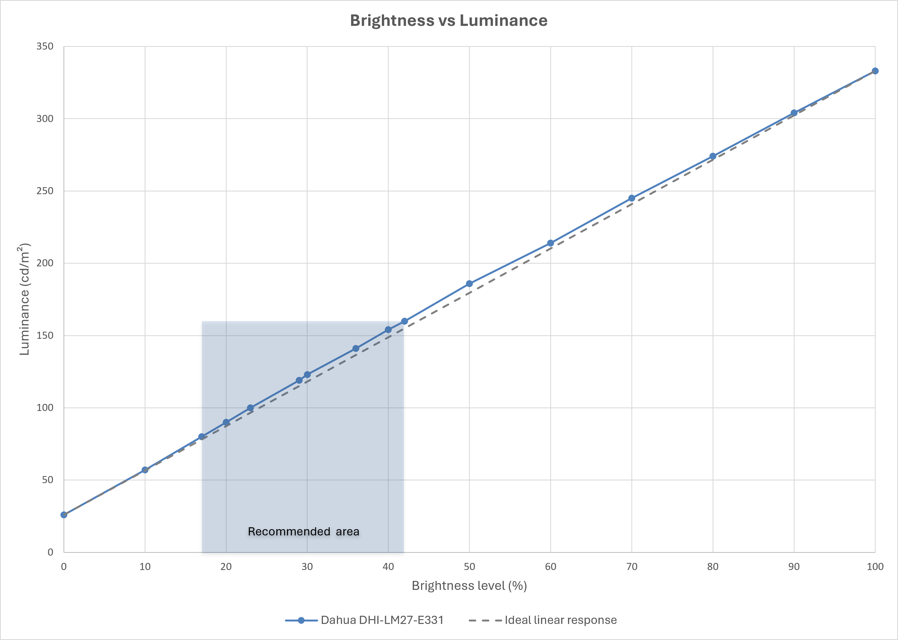

<!-- PAGE_STATUS: OK -->

# Dahua DHI-LM27-E331A   

27-inch QHD IPS gaming monitor featuring a **wide-gamut LED backlight**, 180 Hz refresh rate, Adaptive-Sync, and 1 ms MPRT response time.

Calibration objective: **comfortable everyday use with reduced eye strain during prolonged use, targeting the sRGB color space.**

Official product page:  <https://display.dahuasecurity.com/consumer/en/products/productDetail?product_id=139647>  

## Table of contents

- [Specifications](#specifications)
  - [Color characteristics](#color-characteristics)
- [Calibration](#calibration)
  - [Environment and targets](#environment-and-targets)
  - [OSD settings](#osd-settings)
- [Downloads](#downloads)
- [Brightness response curve](#brightness-response-curve)

## Specifications  

| Parameter           | Value           |
| ------------------- | --------------- |
| Screen size         | 27"             |
| Panel type          | IPS             |
| Aspect ratio        | 16:9            |
| Resolution          | 2560 × 1440     |
| Backlight           | E-LED           |
| Refresh rate        | 180 Hz          |
| Brightness(typ)     | 300 cd/m² (max) |
| Contrast ratio      | 1000:1          |
| Viewing angle (H/V) | 178°(H)/178°(V) |
| Response time       | MPRT 1 ms       |

### Color characteristics  

**Gamut coverage**
|      Color gamut       | Declared/known coverage | Calibrated and measured coverage |
| :--------------------: | :------------------------: | :---------------------------------: |
| Wide color gamut (WDC) |     :heavy_check_mark:     |         :heavy_check_mark:          |
|          sRGB          |           ~ 99%            |               99.84%                |
|          NTSC          |           ~ 85%            |                  -                  |
|         DCI-P3         |             -              |               90.15%                |
|       Adobe-RGB        |             -              |               80.63%                |
   
**Color depth:** `8 bit`  

  <a href="#table-of-contents">⬆ Toc</a>

## Calibration  

### Environment and targets

**Calibration environment**
| Parameter                        | Value                                |
| -------------------------------- | ------------------------------------ |
| Calibration date                 | 2026-11-24 (YYYY-MM-DD)              |
| Instrument                       | Calibrite Display PRO HL rev. D      |
| Calibration & profiling software | DisplayCal 3.9.19 ArgyllCMS 3.5.0 |

**Calibration target**
| Parameter          | Value                         |
| ------------------ | ----------------------------- |
| Preset             | Office & Web (D65, Gamma 2.2) |
| Target white point | D65 (6500 K)                  |
| Target gamma       | 2.2                           |
| Target luminance   | 120 cd/m²                     |

### OSD settings  

- Display menu:  
    - Brightness: 29  
    - Contrast: 50  
    - Black equalize: 50  
    - Sharpness: 50
    - Preset: User
    - Sharpness: 50  
- Color menu:
    - Color temperature: User
      - Red: 50 (default)  
      - Green: 49 (1 click down from 50) [^1]    
      - Blue: 45 (1 click above 44) [^1]    
    - Gamma: 2.2  
    - Hue: 50  
    - Saturation: 50
    - Low blue light: 0    
- Gaming setup menu:  
    - FreeSync/G-Sync: OFF  
    - Overdrive: OFF  
    - DCR: OFF  
    - MPRT: OFF  
- Advanced menu:  
    - HDR: OFF  
- Refresh rate: 120 Hz fixed
  
[^1]: Colors have several clicks for one value  

  <a href="#table-of-contents">⬆ Toc</a>

## Downloads

> [!IMPORTANT]  
> The ICC profile was created using the OSD settings listed above.  
> Different monitor settings (brightness, RGB gain, contrast, etc.) may reduce color accuracy.  

- [ICC/ICM profile](https://xdenb43.github.io/display-comfort-configurations/monitors/dahua-lm27-e331/DHI-LM27-E331_120cdm2_D6500_2.2_F-S_XYZLUT_MTX.icm)  
- [Verification report (HTML)](https://xdenb43.github.io/display-comfort-configurations/monitors/dahua-lm27-e331/Measurement_Report_DHI-LM27-E331.html)

  <a href="#table-of-contents">⬆ Toc</a>

## Brightness response curve  

Measurement done with DisplayCal interactive display adjustment window

> [!NOTE]
> Recommended luminance levels:
>
> - Night: 80–100 cd/m²
> - Evening: 100–120 cd/m²
> - Daylight: 120–140 cd/m²
> - Bright daylight: 140–160 cd/m²

> [!WARNING]
> OSD brightness levels above ~48% introduce a green color cast, requiring recalibration at the target brightness level.

 

| OSD Brightness (%) | Luminance (cd/m²) |
| :----------------: | :---------------: |
|         0          |        26         |
|         10         |        57         |
|      -> 17 <-      |     -> 80 <-      |
|         20         |        90         |
|      -> 23 <-      |     -> 100 <-     |
|      -> 29 <-      |     -> 119 <-     |
|         30         |        123        |
|      -> 36 <-      |     -> 140 <-     |
|         40         |        154        |
|      -> 42 <-      |     -> 160 <-     |
|         50         |        186        |
|         60         |        214        |
|         70         |        245        |
|         80         |        274        |
|         90         |        304 [^2]   |
|        100         |        333 [^2]   |

[^2]: Measured luminance exceeds the manufacturer's specified maximum SDR brightness of 300 cd/m².  
Values are retained as experimental measurements and have not been independently verified.

  <a href="#table-of-contents">⬆ Toc</a>

